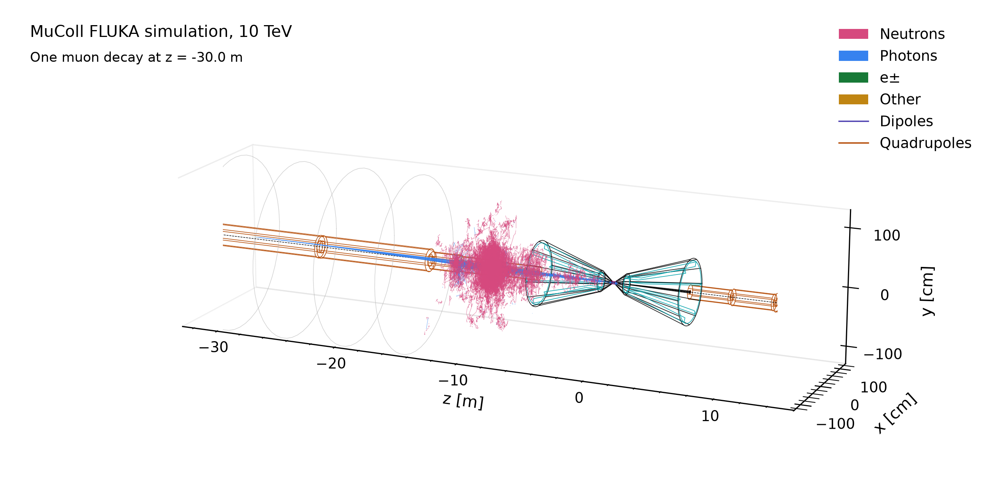
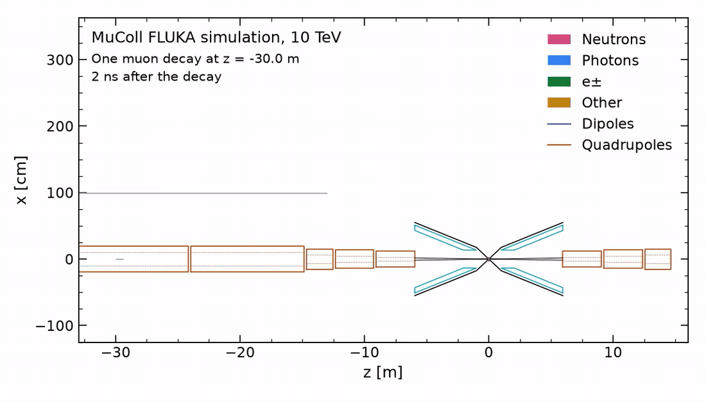

# Muon collider BIB event displays

Displays of single muon decays in the 10 TeV muon collider tunnel: every FLUKA tracking
step of the decay products, drawn over the magnets, nozzles and tunnel of the lattice v0.8
machine-detector interface model.





There are two kinds of display:

- **Static figures and movies** (`plot_traces.py`): all steps projected onto the x-z plane,
  for the tunnel and for the region around the interaction point, a 3D wireframe view, and
  movies of the shower building up in time.
- **Interactive 3D pages** (`make_viewer.py`): self-contained HTML pages with a time
  slider, species and geometry toggles, preset views, and buttons to save an image or
  record the animation as a video. Pages for six decays are online at
  https://leblanc-lab.github.io/mucoll-bib-event-display/ and in `docs/` (open
  `docs/index.html` in a browser). The site is served from the `gh-pages` branch,
  which holds a copy of `docs/`.

## What the displays show

Each display is one forced muon decay (μ⁺ beam travelling towards +z, interaction point at
the origin). Colours give the particle species: e±, photons, neutrons and everything else.
The violet and orange outlines are the dipoles and quadrupoles (yoke and aperture), the
cones around the interaction point are the tungsten nozzles with their borated layer, and the grey rings are the
tunnel wall.

The decays were picked by hand at chosen positions. They illustrate what a decay at that
position does; they are not a sample of the decay rate, and the number of particles
reaching the detector varies enormously from one decay to the next.

The 3D views draw a random subsample of the steps with a fixed maximum per species, so the
species are not shown in proportion: about 98% of all steps are e±, 2% photons and 0.1%
neutrons. The 2D projections use every step.

## Making displays from existing traces

Python with `numpy` and `matplotlib` (tested with Python 3.11); `ffmpeg` with VP9 support for the movies.

```bash
python plot_traces.py --traces <traces dir> --out output            # figures and movies
python plot_traces.py --traces <traces dir> --out output --no-movies z030
python make_viewer.py --traces <traces dir> --out viewer            # interactive pages
```

`<traces dir>` holds one folder per decay, each with `trace001_TRACKS.dat` and
`trace001_DET_IP.dat`. Run names after the options restrict the job to those folders.
Figures take one to a few minutes per decay, the movies several more.

The accelerator outline comes from `geometry/mdi_v0p8.json`, so the FLUKA input is not
needed. To extract it again from an input:

```bash
python mdi_geometry.py path/to/lattice_v_0p8_EU_BIB_.inp
```

## Making new traces

This needs FLUKA and the MuColl MDI simulation package for lattice v0.8 (the input, the
trajectory file and the user routines in `src/exe_decay_and_scoring`).

1. Copy `src/exe_decay_and_scoring` and apply the patch, which makes `mgdraw` write every
   track segment in addition to its normal output:

   ```bash
   cp -r <mdi package>/src/exe_decay_and_scoring trace_exe && cd trace_exe
   rm -f *.o fluka.x
   patch mgdraw_in_noz_area.f < ../fluka/mgdraw_trace.patch
   make
   ```

2. Run one decay in a chosen window of z (in cm):

   ```bash
   export BIB_INPUT=<mdi package>/fluka_inputs/lattice_v_0p8_EU_BIB_.inp
   export BIB_TRAJ=<mdi package>/fluka_inputs/run/TRAJb.dat
   export TRACE_EXE=$PWD/trace_exe/fluka.x
   fluka/run_trace.sh z030 -3100 -2900 13 traces
   ```

Do not use the patched executable for production: the step file is 0.1 to 7 GB per decay.

## File formats

`TRACKS.dat`: 36 bytes per track segment, little-endian, no record markers.

| Field | Type | Meaning |
|---|---|---|
| id | int32 | FLUKA particle code (3 e⁻, 4 e⁺, 7 photon, 8 neutron, ...) |
| Ekin | float32 | kinetic energy [GeV] |
| t | float32 | time since the muon decay at the end of the step [s] |
| x0, y0, z0 | float32 | start of the step [cm] |
| x1, y1, z1 | float32 | end of the step [cm] |

`DET_IP.dat`: the particles entering the detector region, 96 bytes each; see
`read_det_ip.py`.

## Files

| File | Purpose |
|---|---|
| `plot_traces.py` | static figures and movies |
| `make_viewer.py`, `viewer_template.html` | interactive pages |
| `mdi_geometry.py`, `geometry/mdi_v0p8.json` | accelerator outline |
| `read_det_ip.py` | reader for the detector-entry records |
| `house_style.py` | figure style |
| `fluka/` | `mgdraw` patch and run script for new traces |
| `vendor/` | three.js r128 and OrbitControls (MIT licence) |
| `docs/` | prebuilt interactive pages and example images |
